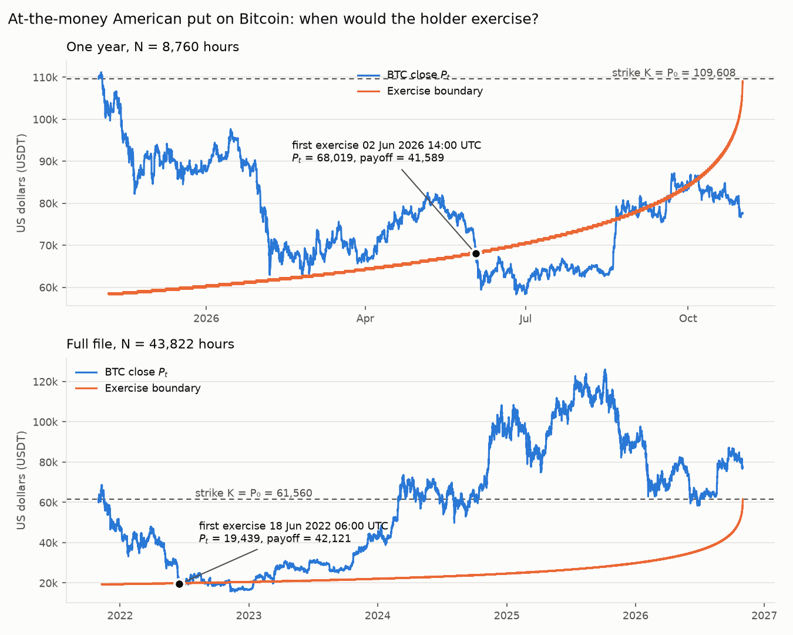

# Class 3 lab: `PriceAmericanPut` on market data

Submission of Yannick Welscher for *Algorithms in Finance*, Class 3 lab (slides 28-31 of
the Class 3 deck): price an at-the-money American put on hourly market data with a
calibrated binomial tree, read off the early-exercise boundary, and scale up from one
asset and one year to 40 assets and five years while recording time and memory.

## Quick start

From `Submissions/WelscherYannick/`, after `git pull` of the course repository (the data
are in `Class3/data/hourly/` at the repository root). Tested with CPython 3.13.15 and
NumPy 2.5.5 on macOS 26, Apple M4 Pro (14 cores, 24 GB RAM).

```bash
.venv/bin/python -m pytest Class3/tests                              # 599 checks, < 1 s
.venv/bin/python Class3/lab.py --assets BTCUSDT --horizon 1y         # Tasks 2-3, ~3 s
.venv/bin/python Class3/lab.py --assets BTCUSDT --horizon 5y         # Task 4, ~1.5 min
.venv/bin/python Class3/lab.py --assets all --horizon 5y --engine numpy   # Task 5, ~75 s
.venv/bin/python Class3/measure.py time      # Task 6: all timed runs, ~60 min
.venv/bin/python Class3/measure.py memory    # Task 6: all traced runs, ~70 min
.venv/bin/python Class3/measure.py table     # results/runs.md and results/assets_summary.md
.venv/bin/python Class3/full_tree.py         # memory experiment, ~1 min
.venv/bin/python Class3/plot.py              # figure; needs matplotlib
```

The pure-Python engine and the calibration use the standard library only; NumPy is
needed for `--engine numpy`, matplotlib only for the figure.

| File | Content |
|---|---|
| `american_put.py` | `price_american_put` (slides 23-26, line by line), `..._with_boundary`, the NumPy engine, a European reference |
| `calibrate.py` | Loading the CSV files, the window of the last N + 1 closes, the calibration of slide 30, the Task 3 check |
| `lab.py` | One run = one process: load, calibrate, price, check exercise; prints N, assets, seconds, memory |
| `measure.py` | Task 6: every configuration in a fresh process, then the tables |
| `full_tree.py` | Memory experiment: two arrays versus storing the whole tree |
| `plot.py` | Figure of the Bitcoin closes against the exercise boundary |
| `tests/` | Correctness checks (Task 1) and calibration checks |
| `results/` | All measured output (CSV, JSON lines, Markdown tables, figure) |
| `AI_LOG.md` | How the AI assistant was used and which decisions are mine |

## Model, calibration and conventions

* **Window:** the last N + 1 hourly closes P_0, ..., P_N of a file. "One year" is
  N = 8,760; "five years" is the full file, N = 43,822 (see the missing hour below).
* **Contract:** American put written at P_0 and expiring at P_N, strike K = S_0 = P_0,
  exercisable at hours 0, 1, ..., N.
* **Tree:** one period per hourly price change; s = sample standard deviation (divisor
  N - 1) of r_t = ln(P_t / P_{t-1}); u = e^s, d = 1/u; R = e^(0.04 T / N);
  q = (R - d) / (u - d). `calibrate` checks d < R < u for every asset.
* **T** is measured from the timestamps. **Year = 365 days = 8,760 hours** (our choice;
  the slides call N = 8,760 one year), so the one-year window has T = 1 exactly.
* **Missing hour:** all 40 files lack 24 March 2023 13:00 UTC (the README says hours
  without trades are missing). The 12:00 → 14:00 change is one period of the tree, and T
  counts both hours, so in the full file T = 43,823 h / 8,760 = 5.0026 years for
  N = 43,822 periods. The one-year windows do not contain the gap.
* **Exercise rule:** exercising at node (t, j) is optimal when the payoff K - S_{t,j} is
  strictly positive and at least the continuation value (ties count as exercise). The
  **boundary** at date t is the highest tree price with that property, or none. At
  expiry the continuation value is 0, so the boundary at N is the highest tree price
  below K.
* **Task 3** compares the observed close P_t (not itself a tree price) with the boundary
  of the tree calibrated at date 0: the first t with P_t ≤ boundary_t.
* **40 assets** = the 40 files in `Class3/data/hourly/` (Bitcoin, Pax Gold and 38 further
  cryptocurrencies). The S&P 500 file is not part of the runs: it is not in the
  repository (licence), covers only about three years of New York trading hours, and
  cannot fill a five-year window.

### Two engines, identical numbers

`price_american_put_with_boundary` is the reference: pure Python, two lists of N + 1
entries, the loop over j in increasing order. `price_american_put_numpy` keeps the
backward loop over dates in Python and replaces the loop over the nodes of one date by
vectorised NumPy operations on preallocated buffers. Each node uses the same
floating-point operations in the same order (S/d, (q·V[j+1] + (1-q)·V[j])/R, K - S), so the
tests require **bit-identical** values and boundaries, and `measure.py table` re-checks
that the 40-asset result files of both engines agree. Work is Θ(N²) for both; the NumPy
engine only lowers the constant.

## Task 1: correctness

`tests/test_american_put.py` and `tests/test_calibrate.py` (599 checks):

* Slide tree (S0 = K = 100, u = 1.2, d = 0.8, R = 1.05, N = 2) in exact `Fraction`
  arithmetic: **1175/147 = 7.9932**; the float version rounds to 7.9932. The European put
  on the same tree is 6.2925; the one-period replication example is 150/21 = 7.14.
* Boundary on the slide tree: `[none, 80, 96]` (t = 1: exercise at 80 because 20 > 15.24;
  t = 2: 64 and 96 are in the money, 144 is not).
* 576 exact cases (N = 0-7, three spots, four strikes including K = 0, two (u, d) pairs, three
  rates) against two independent oracles: a recursive one that walks all 2^N paths and a
  full-tree one that stores every node and reads off the boundary.
* Properties on random inputs: American ≥ European, American ≥ intrinsic value, value ≤ K,
  boundary below K and on the tree; the NumPy engine equals the pure-Python engine exactly.
* Calibration: window of N + 1 closes, sample standard deviation against
  `statistics.stdev`, R and T including a missing hour, the Task 3 search, and the shape of
  the lab data (40 files, 43,823 closes, first and last timestamp).

## Tasks 2 and 3: Bitcoin, last year (N = 8,760)

Window 31 Oct 2025 23:00 to 31 Oct 2026 23:00 UTC.

| Quantity | Value |
|---|---|
| S0 = K = P_0 | 109,608.01 USDT |
| s (hourly) / annualised s·√8760 | 0.0046074 / 43.1 % |
| u, d | 1.0046180, 0.9954032 |
| R per hour, q | 1.0000045662, 0.499344 |
| **American put value** | **16,713.71 USDT per BTC (15.25 % of S0)** |
| European put on the same tree / Black-Scholes | 16,272.73 / 16,273.25 |
| Early-exercise premium | 440.99 |
| Boundary | none for t < 136 (the lowest tree node S0·d^t is still above the exercise region); 58,574.81 at t = 136, rising to 108,602.63 at t = N (highest tree price below K) |

The full boundary is in `results/BTCUSDT_1y_boundary.csv` (columns t, timestamp, P_t,
boundary). On dates of equal parity it never decreases: closer to expiry the holder
exercises at higher prices.

**Task 3: yes, the holder would have exercised** at **2 June 2026 14:00 UTC** (t = 5,127):
P_t = 68,019.30 ≤ boundary 68,193.47, payoff K - P_t = **41,588.71 USDT** (37.9 % of K).



## Task 4: Bitcoin, full file (N = 43,822)

Window 1 Nov 2021 00:00 to 31 Oct 2026 23:00 UTC, T = 5.0026 years (one missing hour).

| Quantity | Value |
|---|---|
| S0 = K = P_0 | 61,560.49 USDT |
| s (hourly) / annualised | 0.0053961 / 50.5 % |
| u, R per hour, q | 1.0054106, 1.0000045663, 0.499074 |
| **American put value** | **20,716.75 USDT per BTC (33.65 % of S0)** |
| Black-Scholes European put, same s and rate | 18,700.15, so early exercise is worth about 2,017 |
| Boundary | none for t < 215; 19,295.42 at t = 215 (9 Nov 2021), rising towards K at expiry |
| Pure Python / NumPy | 77.7 s / 1.9 s, identical value, boundary and exercise date |

**Exercise: yes**, at **18 June 2022 06:00 UTC** (t = 5,502), in the 2022 crypto crash:
P_t = 19,439.26 ≤ boundary 19,823.10, payoff **42,121.23 USDT** (68.4 % of K). The
one-year window and the full file give different contracts (different P_0 = K, T and s), so
their exercise dates are not comparable.

*Floating-point note.* In this window N is even, so the middle expiry node has the exact
price S0·u^(N/2)·d^(N/2) = S0 = K and payoff 0. After 43,822 multiplications and divisions
it comes out as K − 2.6·10⁻⁸, so it counts as in the money and the boundary at t = N is
61,560.48999997 instead of S0·d² = 60,899.69. The value changes by less than 10⁻⁸ and no other
date or the exercise check is affected; a relative tolerance on the payoff (or prices
computed as S0·e^((2j−t)s)) would remove the artefact. In the one-year window the same node
rounds to at least K and the boundary at N is S0·d² = 108,602.63 as expected.

## Task 5: all 40 assets in one run

`lab.py --assets all` prices the 40 files one after another in one process, for one year
(N = 8,760) and for the full file (N = 43,822). All files share the same timestamps, so
every asset has the same N and T. Per-asset results: `results/assets_all_<horizon>_<engine>.csv`
(window, S0, s, u, d, R, q, value, boundary count, first exercise); both engines give
identical files.

* **Put value is a function of volatility alone.** With K = S0 the value as a share of S0
  depends only on u, d, R and N, and R and N are the same for every asset, so the ranking
  by value is exactly the ranking by s (Spearman 1.000). One year: from 7.9 % of S0 (Tron,
  s = 0.0026) and 9.1 % (Pax Gold) to 49.1 % (Enjin, s = 0.0149), median 29.3 %. Five years:
  from 12.7 % (Pax Gold) to 70.0 % (Synthetix), median 61.7 %.
* **Exercise.** One year: 36 of 40 holders would have exercised, 16 of them in June 2026
  (the drawdown that also triggers Bitcoin); never: NEAR, TRX, UNI, ZEC. Five years: 36 of 40,
  most often in the 2022 crash (16 of 36 in 2022: June 5, November-December 9); never: BNB, PAXG,
  TRX, XRP. Their closes never fell to the boundary, which early in a five-year contract
  lies far below K (Bitcoin: about 31 % of K in 2021-22), and all four ended above
  their November 2021 price (XRP +11 %, BNB +33 %, PAXG +119 %, TRX +200 %).
* Gold (PAXG) is the low-volatility reference: one-year put 9.1 % of S0, exercised only
  eleven hours before expiry with a payoff of 2.6 % of K.

Per asset (s = hourly volatility; payoff of the first exercise in % of K):

| Asset | s (1y) | Put % of S0 (1y) | First exercise (1y) | Payoff % of K (1y) | s (5y) | Put % of S0 (5y) | First exercise (5y) | Payoff % of K (5y) |
|---|---:|---:|---|---:|---:|---:|---|---:|
| AAVE | 0.00890 | 30.20 | 2026-05-28 03:00 | 64.6 | 0.01062 | 62.92 | 2026-05-18 03:00 | 72.1 |
| ADA | 0.00813 | 27.58 | 2026-05-27 22:00 | 61.1 | 0.00946 | 57.45 | 2022-12-19 17:00 | 87.0 |
| ALGO | 0.00864 | 29.31 | 2026-07-29 17:00 | 56.6 | 0.01039 | 61.92 | 2022-12-16 22:00 | 89.9 |
| ATOM | 0.00772 | 26.19 | 2026-07-24 10:00 | 52.8 | 0.00958 | 58.07 | 2024-07-05 00:00 | 84.4 |
| AVAX | 0.00768 | 26.05 | 2026-06-04 10:00 | 58.4 | 0.01048 | 62.31 | 2025-11-21 09:00 | 79.7 |
| AXS | 0.01170 | 39.36 | 2026-10-25 05:00 | 33.4 | 0.01117 | 65.33 | 2022-09-18 21:00 | 91.1 |
| BCH | 0.00765 | 25.94 | 2026-06-05 06:00 | 58.1 | 0.00877 | 53.88 | 2022-11-09 21:00 | 85.2 |
| BNB | 0.00478 | 15.86 | 2026-02-11 08:00 | 45.3 | 0.00632 | 39.63 | never |  |
| BTC | 0.00461 | 15.25 | 2026-06-02 14:00 | 37.9 | 0.00540 | 33.65 | 2022-06-18 06:00 | 68.4 |
| CHZ | 0.00927 | 31.42 | 2026-07-31 05:00 | 59.0 | 0.01066 | 63.11 | 2024-08-04 16:00 | 87.2 |
| COMP | 0.00888 | 30.11 | 2026-10-14 18:00 | 35.6 | 0.01080 | 63.71 | 2022-06-14 01:00 | 90.5 |
| CRV | 0.00952 | 32.27 | 2026-10-25 07:00 | 27.8 | 0.01225 | 69.60 | 2024-04-13 20:00 | 91.5 |
| DASH | 0.01428 | 47.26 | 2026-10-31 17:00 | 8.8 | 0.01086 | 64.00 | 2024-06-18 01:00 | 88.1 |
| DOGE | 0.00721 | 24.41 | 2026-06-05 06:00 | 55.1 | 0.00998 | 59.97 | 2026-06-04 08:00 | 68.4 |
| DOT | 0.00865 | 29.37 | 2026-06-03 03:00 | 63.1 | 0.00933 | 56.80 | 2022-10-21 08:00 | 86.7 |
| EGLD | 0.00912 | 30.93 | 2026-06-04 01:00 | 64.9 | 0.01006 | 60.38 | 2023-06-10 02:00 | 87.9 |
| ENJ | 0.01490 | 49.07 | 2026-10-25 06:00 | 40.7 | 0.01221 | 69.45 | 2023-10-10 08:00 | 91.6 |
| ETC | 0.00716 | 24.26 | 2026-06-05 02:00 | 55.6 | 0.00914 | 55.83 | 2025-10-10 21:00 | 76.7 |
| ETH | 0.00626 | 21.09 | 2026-06-02 14:00 | 49.5 | 0.00714 | 44.70 | 2022-06-18 19:00 | 78.8 |
| FIL | 0.01112 | 37.50 | 2026-10-22 14:00 | 35.8 | 0.01070 | 63.30 | 2022-06-12 00:00 | 90.3 |
| GRT | 0.00873 | 29.60 | 2026-06-04 01:00 | 64.1 | 0.01109 | 64.97 | 2022-06-15 08:00 | 91.1 |
| HBAR | 0.00759 | 25.73 | 2026-05-28 03:00 | 58.8 | 0.01034 | 61.67 | 2022-11-09 21:00 | 89.7 |
| ICP | 0.01154 | 38.85 | 2026-10-31 04:00 | 15.3 | 0.01125 | 65.66 | 2022-11-09 09:00 | 91.1 |
| LINK | 0.00735 | 24.90 | 2026-06-05 06:00 | 56.5 | 0.00955 | 57.90 | 2026-02-05 23:00 | 73.9 |
| LTC | 0.00657 | 22.20 | 2026-06-04 01:00 | 52.5 | 0.00843 | 52.10 | 2026-01-31 17:00 | 69.9 |
| MANA | 0.00870 | 29.51 | 2026-05-28 03:00 | 63.7 | 0.01076 | 63.56 | 2022-12-30 07:00 | 90.0 |
| NEAR | 0.01114 | 37.58 | never |  | 0.01183 | 68.01 | 2025-12-01 01:00 | 83.5 |
| NEO | 0.00751 | 25.46 | 2026-06-05 18:00 | 57.3 | 0.00977 | 58.98 | 2025-03-09 22:00 | 82.4 |
| PAXG | 0.00288 | 9.07 | 2026-10-31 12:00 | 2.6 | 0.00239 | 12.75 | never |  |
| SAND | 0.00992 | 33.59 | 2026-06-02 15:00 | 69.4 | 0.01133 | 65.96 | 2025-04-07 03:00 | 86.5 |
| SNX | 0.00977 | 33.10 | 2026-03-27 18:00 | 72.4 | 0.01235 | 69.97 | 2025-02-03 01:00 | 89.4 |
| SOL | 0.00690 | 23.35 | 2026-04-02 01:00 | 57.6 | 0.01022 | 61.13 | 2022-11-09 01:00 | 89.1 |
| THETA | 0.00971 | 32.91 | 2026-06-05 02:00 | 67.5 | 0.01094 | 64.34 | 2023-06-08 03:00 | 89.8 |
| TRX | 0.00255 | 7.89 | never |  | 0.00555 | 34.70 | never |  |
| UNI | 0.01034 | 34.98 | never |  | 0.01064 | 63.02 | 2025-12-15 16:00 | 80.0 |
| VET | 0.00814 | 27.61 | 2026-05-27 22:00 | 60.9 | 0.00979 | 59.07 | 2022-12-19 03:00 | 87.8 |
| XLM | 0.00851 | 28.87 | 2026-10-08 15:00 | 38.0 | 0.00901 | 55.18 | 2026-08-06 13:00 | 57.2 |
| XRP | 0.00678 | 22.94 | 2026-06-04 01:00 | 53.7 | 0.00866 | 53.33 | never |  |
| XTZ | 0.00822 | 27.87 | 2026-06-10 04:00 | 59.9 | 0.00946 | 57.47 | 2022-12-17 20:00 | 86.9 |
| ZEC | 0.01405 | 46.59 | never |  | 0.01204 | 68.82 | 2024-07-05 02:00 | 90.5 |

1y: exercised for 36 of 40 assets; never: NEAR, TRX, UNI, ZEC.

5y: exercised for 36 of 40 assets; never: BNB, PAXG, TRX, XRP.

## Task 6: time and memory of every run

Each row is one process (`measure.py`). Seconds and max RSS come from the timed run;
the traced peak comes from a separate run of the same configuration under tracemalloc.
"Seconds (total)" includes loading and calibrating every file; "pricing" is the
`PriceAmericanPut` calls alone. Raw data: `results/runs_time.jsonl`,
`results/runs_memory.jsonl`, `results/runs.csv`; machine and versions in
`results/metadata_*.json`.

| Engine | Assets | Horizon | N | Seconds (total) | Seconds (pricing) | Peak traced (MiB) | Max RSS (MiB) |
|---|---:|---|---:|---:|---:|---:|---:|
| numpy | 1 | 1y | 8760 | 0.14 | 0.13 | 6.8 | 34.2 |
| numpy | 1 | 5y | 43822 | 1.88 | 1.86 | 12.6 | 40.9 |
| numpy | 40 | 1y | 8760 | 4.98 | 4.32 | 9.4 | 37.9 |
| numpy | 40 | 5y | 43822 | 75.46 | 74.68 | 12.7 | 44.4 |
| python | 1 | 1y | 8760 | 3.14 | 3.12 | 4.0 | 28.3 |
| python | 40 | 1y | 8760 | 124.49 | 123.85 | 4.1 | 29.7 |
| python | 1 | 5y | 43822 | 77.71 | 77.69 | 7.7 | 33.2 |
| python | 40 | 5y | 43822 | 3109.61 | 3108.79 | n/a | 35.1 |

**Time binds, memory does not.**

* **Work is Θ(N²).** Pure Python, Bitcoin: 3.14 s → 77.71 s when N grows from 8,760 to
  43,822, a factor of 24.7; (43,822 / 8,760)² = 25.0. Every date t touches t + 1 nodes, so
  the backward pass makes N(N + 1)/2 node updates: 38.4 million for one year and
  960 million for five years.
* **Work is linear in the number of assets.** One year: 3.14 s for Bitcoin, 124.49 s for 40
  assets (39.6 ×). Five years: 77.71 s for Bitcoin, 3,109.61 s = 51.8 minutes for 40 assets
  (40.0 ×). Every asset has the same N, so the same work.
* **The NumPy engine** does the same Θ(N²) work with a smaller constant: 1.9 s instead of
  77.7 s for Bitcoin over five years (41 ×), 75 s for all 40 assets. Its growth from one to
  five years is only 13 × because at N = 8,760 the fixed cost of about a dozen NumPy calls
  per date is still a large share; at N = 43,822 the per-node work dominates.
* **Memory stays flat.** Max RSS is 28-45 MiB in every timed run: the interpreter, NumPy
  and the parsed input dominate. The runs hold one asset at a time, so 40 assets need no
  more memory than one. The traced peak (a few MiB) is mostly the parsed CSV file
  (43,823 `datetime` and `float` objects ≈ 3.7 MiB), not the algorithm: its workspace
  is two arrays plus the boundary, about 52 bytes per period in pure Python
  (`full_tree.py`), i.e. about 0.4 MiB at N = 8,760 and 2.2 MiB at N = 43,822.
* **Not traced: python / 40 assets / five years.** Under tracemalloc the pure-Python engine took 1,512 s for Bitcoin alone (19 × slower), so this run would take about 17 hours. Its traced peak is bounded by python / Bitcoin / five years (7.7 MiB): the run holds one asset at a time, which the one-year runs confirm (4.0 MiB for one asset, 4.1 MiB for 40).

## Scale up until memory binds

The two-array design is why memory never binds above. `full_tree.py` measures the
alternative that stores the whole tree (stock price and put value for all
(N + 1)(N + 2)/2 nodes) and extrapolates from the measured bytes per node
(`results/full_tree_memory.csv`). Same value from both storage choices in every case.

| Storage | Cost | Measured, N = 4,000 | N = 8,760 (one year) | N = 43,822 (five years) |
|---|---|---:|---:|---:|
| Two arrays, pure Python | ~52 B per period | 0.20 MiB | ~0.4 MiB | ~2.2 MiB |
| Two arrays, NumPy | ~86 B per period | 0.33 MiB | 0.72 MiB (measured) | ~3.6 MiB |
| Full tree, Python lists | 58.6 B per node | 447 MiB | ~2.1 GiB | **~52 GiB** |
| Full tree, NumPy (N + 1)² arrays | 32 B per node | 244 MiB | 1.14 GiB (measured) | **~29 GiB** |

On this machine (24 GB RAM) the full tree fits for one year but not for five years, even
for a single asset; pricing 40 assets at once would multiply it by 40. The two arrays
need a few MiB at every size: going from Θ(N²) to Θ(N) auxiliary space is what lets the lab
scale to five years. What remains is Θ(N²) time.

## Limitations

* **Hindsight in s.** The volatility is estimated from the whole window, including prices
  after date 0, so Task 3 uses information the holder would not have had at P_0.
* **One tree, fixed at date 0.** The boundary is not re-calibrated as time passes; Task 3
  compares real closes with that fixed boundary. Real closes are not tree prices.
* **Model:** constant volatility, 4 % continuously compounded rate, no dividends (none on
  these tokens), no fees or funding, USDT treated as US dollars.
* **Measurements:** the time and memory suites ran in parallel on different cores. The
  timed `python/BTC/1y` run (3.14 s) matches an isolated run (3.10 s), and the 40-asset
  five-year run averages 77.74 s per asset against 77.71 s for Bitcoin alone, so the
  parallel suite did not distort the timings visibly. Absolute times depend on the
  machine; compare ratios. One run per configuration (no repeats): the long runs take
  minutes, so their noise is small relative to the effects reported.
